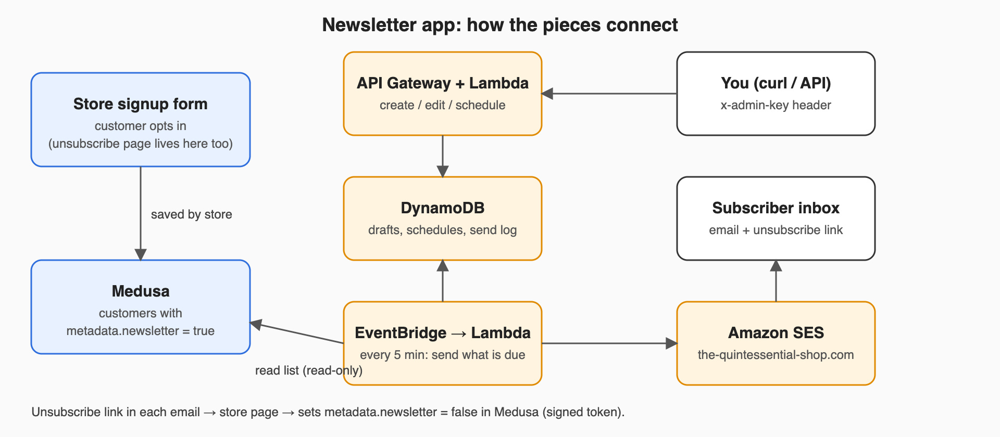
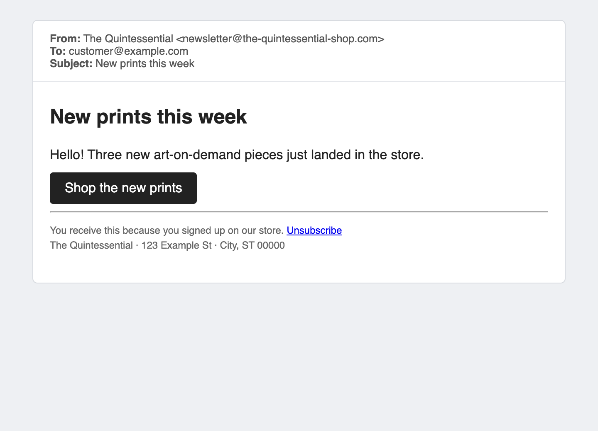

# Rashad's Newsletter App

Create, schedule and send newsletter emails. Runs on AWS serverless (Lambda + DynamoDB + SES). The subscriber list is **not** stored here – recipients are fetched read-only from the store's Medusa at send time. Plan and decisions: [docs/DESIGN.md](docs/DESIGN.md).

## How it fits together



## What an email looks like

Every email gets an unsubscribe footer and `List-Unsubscribe` headers automatically (illustrative sample):



The code is TypeScript (strict). `npm run docs:images` regenerates these pictures (needs Google Chrome).

## Local run
```bash
npm install
# export the variables from .env.example (ADMIN_KEY, UNSUBSCRIBE_* are required)
npm start    # in-memory storage, dry-run mail (MAIL_FROM empty)
npm test
npm run typecheck   # TypeScript strict check
```

## API (header `x-admin-key`, except `/health`)
- `POST /emails` `{subject, bodyHtml}`; `GET /emails`, `GET /emails/:id`, `PUT /emails/:id`
- `POST /emails/:id/schedule` `{scheduledAt}` – future ISO date
- `POST /emails/:id/send` – queue now (goes out on the next scheduler run, within 5 min)
- `GET /emails/:id/log` – per-recipient results

Every email gets a per-recipient unsubscribe link and `List-Unsubscribe` headers automatically.

## Deploy (AWS SAM)
```bash
sam build && sam deploy --guided   # asks for the parameters in template.yaml
```
Step-by-step guide: [docs/DEPLOY.md](docs/DEPLOY.md). SES DNS records: docs/DESIGN.md.
